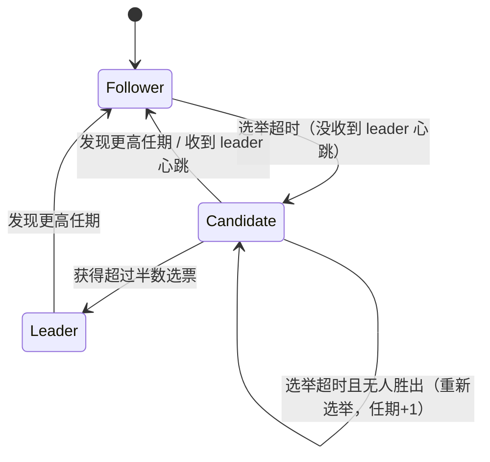

# Lab 3A：Raft 领导人选举与心跳

> 对应代码：[raft.go](file:///Users/rawdon/Desktop/rProject/goProject/MIT6.824/6.5840/src/raft/raft.go)
> 测试：`go test -run 3A`（在 `src/raft` 目录下执行）

---

## 一、本 Lab 的目标

Lab 3A 是整个 Raft 三阶段中的**第一阶段**，只实现**领导人选举（Leader Election）**和**心跳（Heartbeat）**，**不涉及日志复制**（日志复制属于 3B）。

完成后要求：

- 集群中最多只有一个 leader，其余节点为 follower。
- leader 定期发送心跳维持权威；一旦 leader 失联或崩溃，其余节点能在**几秒内**重新选出新 leader，且保证唯一性。
- 选举结果在**大多数节点存活**时总能达成（少数节点失联不影响）。
- 通过 `go test -run 3A`，并确保无死锁、无数据竞争（`-race` 通过）。

---

## 二、前置概念

理解 3A 需要先理清 Raft 的几个基础概念。

### 1. 三种角色

| 角色 | 含义 |
|------|------|
| **Follower** | 被动角色，不主动发请求；只响应候选人/ leader 的 RPC |
| **Candidate** | 发起选举，向其他节点拉票 |
| **Leader** | 选举获胜者，负责接收客户端请求、发送心跳 |

任何时刻每个节点处于且仅处于一种角色。

### 2. 任期（Term）

- 任期是**单调递增的逻辑时钟**，用整数 `currentTerm` 表示。
- 每次开始新选举时，候选人把任期 +1。
- **任期高者优先**：任何节点收到比自己 `currentTerm` 更大的 RPC，立即承认对方、转为 follower 并更新自己的任期。
- 同一任期内最多产生一个 leader；不同任期的 leader 可能描述同一时间段（因为网络分区等），但同一任期只能有一个。

### 3. 选举超时（Election Timeout）

- follower 在一段时间内**没收到任何 leader 的心跳/合法 RPC**，就认为 leader 失联，转为 candidate 发起选举。
- 超时时间必须**随机化**（例如 300~500ms），否则多个 follower 会同时超时、选票被瓜分，导致选票分裂（split vote）而无法产生 leader。

### 4. 心跳（Heartbeat）

- leader 定期（远小于选举超时，例如每 100ms）向所有 follower 发送**空的 AppendEntries RPC**，即心跳。
- 心跳的作用是**声明"我还活着"**，让 follower 重置选举计时器，从而不会发起新选举。

---

## 三、状态与数据结构

对照论文 Figure 2，本实现维护以下状态（见 [Raft struct](file:///Users/rawdon/Desktop/rProject/goProject/MIT6.824/6.5840/src/raft/raft.go#L51-L72)）：

### 持久状态（3C 才做持久化，但结构现在就要定义）

| 字段 | 类型 | 说明 |
|------|------|------|
| `currentTerm` | `int` | 当前任期 |
| `voteFor` | `int` | 本任期投给了谁，`-1` 表示未投 |
| `log` | `[]LogEntry` | 日志条目列表 |

### 易失状态（所有节点）

| 字段 | 类型 | 说明 |
|------|------|------|
| `commitIndex` | `int` | 已知被提交的最大日志索引（3B 用） |
| `lastApplied` | `int` | 已应用到状态机的最大索引（3B 用） |

### 本 Lab 自定义的状态

| 字段 | 类型 | 说明 |
|------|------|------|
| `role` | `Role` | 当前角色：Follower/Candidate/Leader/Dead |
| `electionStartTime` | `time.Time` | 本轮选举计时起点 |
| `electionTimeout` | `time.Duration` | 本节点随机化的选举超时时长 |
| `lastHeartbeat` | `time.Time` | leader 上次发心跳的时间 |

### 日志哨兵条目

`log[0]` 存放一个**哨兵条目** `{Term: 0, Index: 0}`（见 [Make](file:///Users/rawdon/Desktop/rProject/goProject/MIT6.824/6.5840/src/raft/raft.go#L443-L445)）。

作用：让日志**永不为空**，这样取"最后一条日志"的 `rf.log[len(rf.log)-1]` 就不会 panic。新增了 [lastLogTerm](file:///Users/rawdon/Desktop/rProject/goProject/MIT6.824/6.5840/src/raft/raft.go#L123-L125) / [lastLogIndex](file:///Users/rawdon/Desktop/rProject/goProject/MIT6.824/6.5840/src/raft/raft.go#L127-L129) 两个辅助函数封装这个访问。

---

## 四、实现清单

Lab 3A 需要完成的部分：

1. **状态字段**：补齐 `role`、`currentTerm`、`voteFor`、`log`、计时相关字段。
2. **RPC 结构体**：`RequestVoteArgs/Reply` 与 `AppendEntriesArgs/Reply`（字段首字母必须大写，否则无法跨 RPC 序列化）。
3. **`RequestVote` 处理器**：实现投票规则。
4. **`AppendEntries` 处理器**：实现心跳接收逻辑。
5. **选举驱动**：`ticker` 中的超时检测与 `startElection` 拉票流程。
6. **心跳驱动**：`runHeartbeats` 发送空 AppendEntries。
7. **辅助函数**：`GetState`、`Make` 初始化。

---

## 五、核心流程详解

### 5.1 状态转换



三个转换函数都在 `rf.mu` 保护下调用：

- [becomeFollower](file:///Users/rawdon/Desktop/rProject/goProject/MIT6.824/6.5840/src/raft/raft.go#L99-L105)：转为 follower，更新任期，清空选票，**重置选举计时**。
- [becomeCandidate](file:///Users/rawdon/Desktop/rProject/goProject/MIT6.824/6.5840/src/raft/raft.go#L108-L114)：转为 candidate，**任期 +1**，投票给自己，重置计时。
- [becomeLeader](file:///Users/rawdon/Desktop/rProject/goProject/MIT6.824/6.5840/src/raft/raft.go#L118-L121)：转为 leader，重置心跳计时。

### 5.2 选举流程（`startElection`）

见 [startElection](file:///Users/rawdon/Desktop/rProject/goProject/MIT6.824/6.5840/src/raft/raft.go#L132-L168)：

1. 调用 `becomeCandidate()`：任期 +1，投自己一票（`votes` 初始化为 1）。
2. 构造 `RequestVoteArgs`，带上自己的 `Term`、`CandidateID`，以及**自己最后一条日志的 term 和 index**（用于"日志新旧比较"）。
3. 为每个 peer 起一个 goroutine **并发**发送 `RequestVote`。
4. 每个 goroutine 收到回复后：
   - 先校验 `role == Candidate && currentTerm == term`（自己是否还是本次选举的候选人）。
   - 若对方同意：`votes++`，一旦 **`votes > len(peers)/2`**（严格多数）立刻 `becomeLeader`。
   - 若对方 `reply.Term` 更高：`becomeFollower(reply.Term)` 退位。

> 并发拉票的意义：避免一个慢节点阻塞整个选举，缩短选出 leader 的时间。

### 5.3 投票规则（`RequestVote` 处理器）

见 [RequestVote](file:///Users/rawdon/Desktop/rProject/goProject/MIT6.824/6.5840/src/raft/raft.go#L254-L280)，规则按论文 Figure 2：

1. 若 `args.Term < currentTerm` → **拒绝**（对方任期过时）。
2. 若 `args.Term > currentTerm` → 更新任期并转为 follower（清空 `voteFor`）。
3. 投票条件（两个都要满足）：
   - **日志足够新**（"up-to-date"）：
     `args.LastLogTerm > 自身LastLogTerm`，或 term 相同且 `args.LastLogIndex >= 自身LastLogIndex`。
   - **本任期还没投过**或**已投给同一候选人**：`voteFor == -1 || voteFor == args.CandidateID`。
4. 同意投票时记录 `voteFor = args.CandidateID`，并**重置自己的选举计时**。

> 日志新旧比较（5.4.1 节安全性）是 Raft 保证"已提交日志不被覆盖"的核心：只有日志不落后于多数节点的候选人才可能当选。

### 5.4 心跳流程（`runHeartbeats` + `AppendEntries`）

发送端 [runHeartbeats](file:///Users/rawdon/Desktop/rProject/goProject/MIT6.824/6.5840/src/raft/raft.go#L172-L200)：

1. 持锁确认自己仍是 leader，构造**空的** `AppendEntriesArgs`（只含 `Term` 和 `LeaderId`）。
2. **释放锁之后再发 RPC**（关键：持锁发 RPC 会阻塞其他人、甚至死锁）。
3. 并发向所有 peer 发送。
4. 收到回复后若 `reply.Term > currentTerm`，说明自己已过时，`becomeFollower` 退位。

接收端 [AppendEntries](file:///Users/rawdon/Desktop/rProject/goProject/MIT6.824/6.5840/src/raft/raft.go#L301-L323)：

1. 若 `args.Term < currentTerm` → 拒绝，不更新任何计时。
2. 若 `args.Term > currentTerm` → 更新任期、转为 follower、重置选举计时。
3. 若 `args.Term == currentTerm` → 说明**合法 leader 还活着**，仅把角色设为 follower 并**重置选举计时**，**不动 `voteFor`**（同一任期内的选票不应被抹掉）。
4. 返回 `Success = true`。

### 5.5 统一驱动器 `ticker`

见 [ticker](file:///Users/rawdon/Desktop/rProject/goProject/MIT6.824/6.5840/src/raft/raft.go#L395-L418)，是**唯一的长期 goroutine**：

```go
for !rf.killed() {
    time.Sleep(20ms)
    switch rf.role {
    case Follower, Candidate:
        if 距上次选举计时 >= electionTimeout { startElection() }   // 触发选举
    case Leader:
        if 距上次心跳 >= 100ms { runHeartbeats() }                // 触发心跳
    }
}
```

**设计要点**：只在 `Make` 里启动**一个** ticker；角色切换**不再新建 goroutine**，由这个循环按 `rf.role` 分派。这避免了 goroutine 泄漏与多个计时器并发导致的混乱。

---

## 六、关键设计要点与陷阱

### ✅ 正确做法

1. **单 ticker 架构**：一个循环按角色分派选举/心跳，角色切换不新建 goroutine。
2. **锁纪律**：所有共享状态（`role`、`currentTerm`、`voteFor`、计时）访问都在 `rf.mu` 下；`becomeX`、`startElection`、RPC 处理器都要求持有锁。
3. **发 RPC 前先解锁**：`runHeartbeats` 先在锁内构造参数、解锁后再 `Call`，防止持锁阻塞。
4. **随机化选举超时**：`Make` 里为每个节点生成 300~500ms 随机超时，避免选票分裂。
5. **日志哨兵**：`log[0]` 为 `{0,0}`，保证日志非空、取末尾不越界。
6. **回复后二次校验**：投票/心跳的 goroutine 回调里，先确认 `role` 和 `currentTerm` 未变，再决定是否计票/退位（因为等 RPC 返回期间状态可能已变）。
7. **重置计时的时机**：授予投票后、收到合法心跳后都要 `electionStartTime = time.Now()`。

### ❌ 本 Lab 中曾出现的 bug（已修复）

| 问题 | 后果 | 修复 |
|------|------|------|
| `log` 未初始化就用 `rf.log[len(rf.log)-1]` | panic | `Make` 里加入哨兵条目 |
| `becomeFollower` 把 `electionStartTime` 置为零值 | `time.Since(零时间)` 巨大 → 立即超时 → 选票分裂 | 改为 `time.Now()` |
| 每次角色切换都 `go ticker()`，而 `ticker` 自身还循环 | goroutine 泄漏、多计时器并发 | 改为单 ticker 按角色分派 |
| 缺 `AppendEntries` RPC | 心跳没有接收端，follower 永不重置计时 | 补齐处理器与发送函数 |

### 时间参数选择

| 参数 | 取值 | 理由 |
|------|------|------|
| 心跳间隔 | 100ms | 远小于选举超时，保证 follower 不误触发选举 |
| 选举超时 | 300~500ms（随机） | 足够大以免误判，足够小以快速恢复；随机化防分裂 |
| ticker 轮询 | 20ms | 提供足够的时间分辨率 |

> 经验法则：**心跳间隔 ≪ 选举超时**，且选举超时远大于 RPC 往返时间。

---

## 七、测试验证

```bash
cd /Users/rawdon/Desktop/rProject/goProject/MIT6.824/6.5840/src/raft
go test -run 3A              # 基础选举测试
go test -run 3A -race        # 检测数据竞争
```

预期输出：`ok  6.5840/raft  ~14s`

3A 包含的主要测试场景：

- `TestInitialElection3A`：初始能否选出唯一 leader。
- `TestReElection3A`：leader 挂掉后能否重新选举。
- `TestManyElections3A`：反复选举、随机断连下仍保持唯一 leader。
- 断连节点恢复后**不得**破坏当前 leader（`disconnect` 后接回，不应产生两个 leader）。
- `-race` 无报错。

---

## 八、与后续 Lab 的衔接

3A 完成后，以下"钩子"已就位，3B 可直接扩展：

- `AppendEntriesArgs` 中预留了 `PrevLogIndex`、`PrevLogTerm`、`Entries`、`LeaderCommit` 字段（见 [注释处](file:///Users/rawdon/Desktop/rProject/goProject/MIT6.824/6.5840/src/raft/raft.go#L282-L291)）。
- `Start`、`commitIndex`、`lastApplied` 还是空壳，3B 需要实现：日志追加、`nextIndex/matchIndex` 回退、多数派提交判定、以及 `applyCh` 应用循环。
- `persist()` / `readPersist()` 在 3C 实现持久化以通过崩溃恢复测试。

---

## 九、一句话总结

> **单 ticker 驱动 → follower 超时转候选 → 并发拉票 → 多数票当选 leader → leader 定期发空 AppendEntries 心跳维持权威；任何节点发现更高任期即退位**，全程用随机化超时避免选票分裂、用锁 + 日志哨兵保证并发与边界正确。
